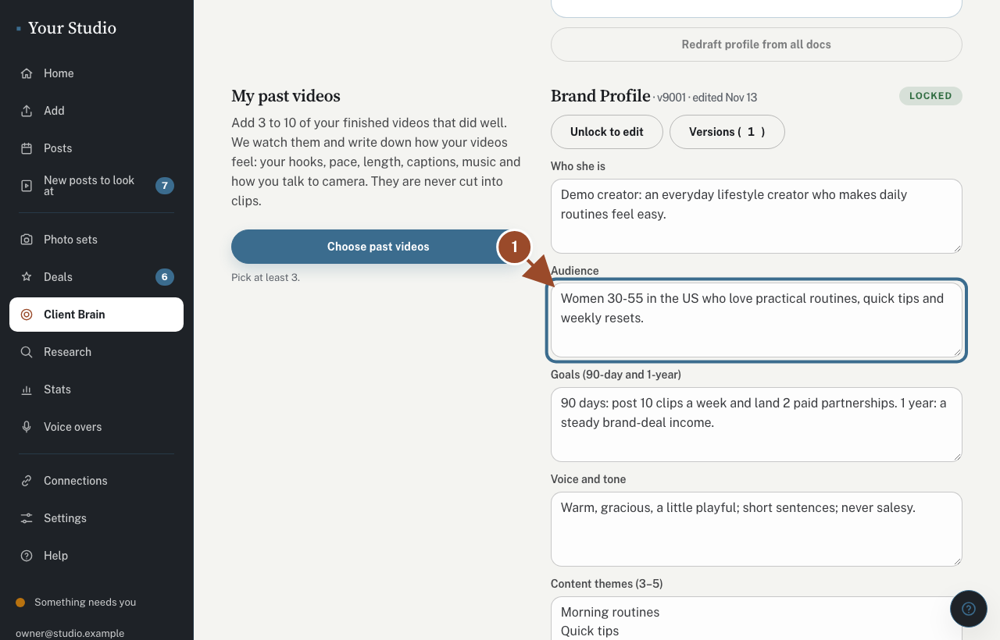
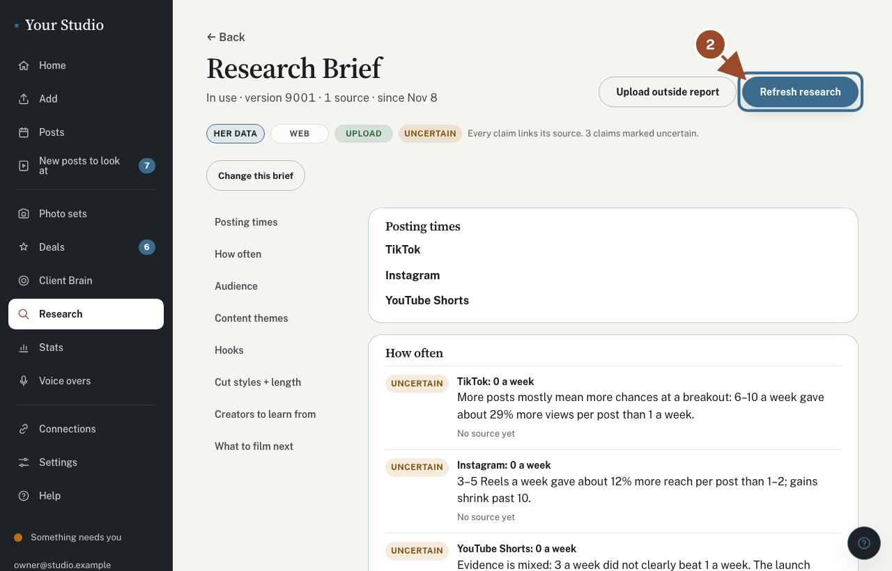
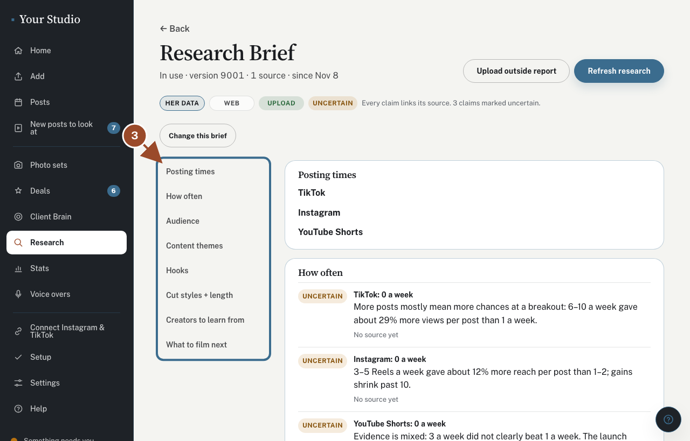
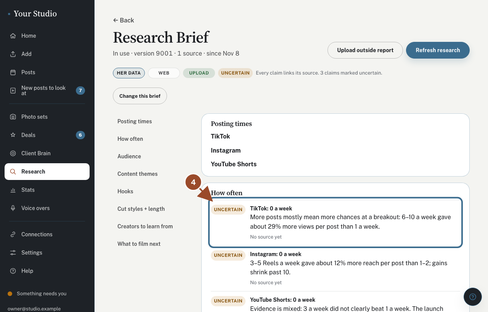
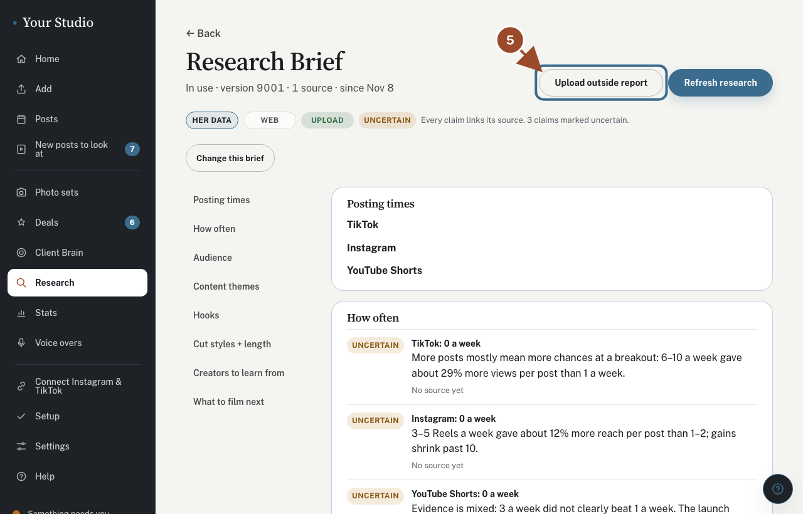
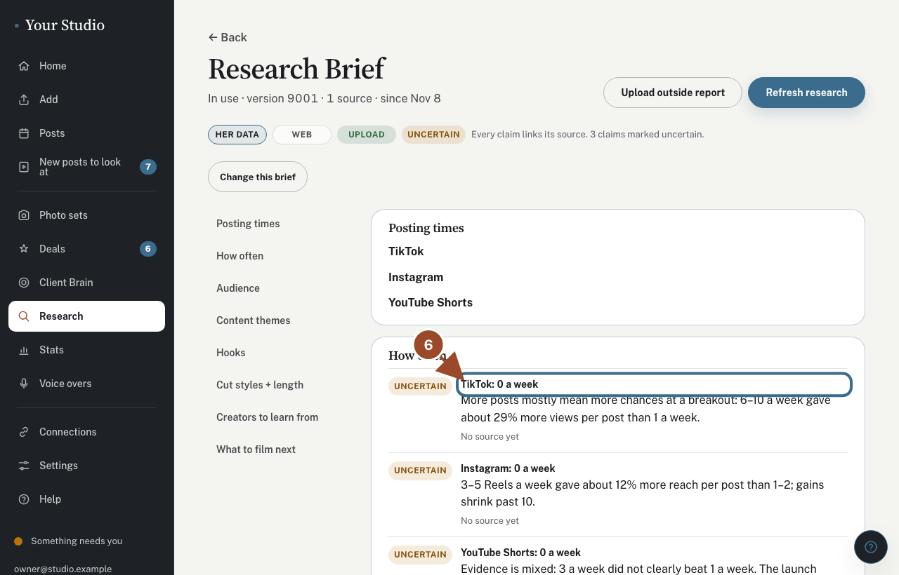

The research brief says when to post, what hooks work and what to film next, with a source for every claim. It is written for you and used right away. Nothing waits for you to approve it.

## Tell the studio about you first

<!-- route: /brain -->
<!-- target: #sec-audience -->

The research starts by itself once **Client Brain** has a few words about you.

## Tap Refresh research

<!-- route: /research -->
<!-- target: role=button[name="Refresh research"] -->

Your first brief starts by itself. For a fresh one later, tap **Refresh research** (5 to 10 minutes).

Uploaded videos already? They are made into posts without waiting for the brief.

## Jump to any section

<!-- route: /research -->
<!-- target: .rs-nav -->

Use the list to jump to posting times, audience, hooks, what to film next and more.

## Check each claim's label

<!-- route: /research -->
<!-- target: .rs-claim >> nth=0 -->

Every claim says where it came from: your own numbers, the web, a report you added, or uncertain. Tap a source to open it.

## Add an outside report (optional)

<!-- route: /research -->
<!-- target: role=button[name="Upload outside report"] -->

Have a ChatGPT or Perplexity report? Tap **Upload outside report**, then **Refresh research**.

## Change anything you like

<!-- route: /research -->
<!-- target: .rs-lead -->

Tap **Change this brief** to change anything, then **Save changes**. A new brief comes each month and is used right away; we tell you in one line when it does.

## Did this work?

If not, tap **No** below and we'll open the matching fix-it guide or email your helper.
