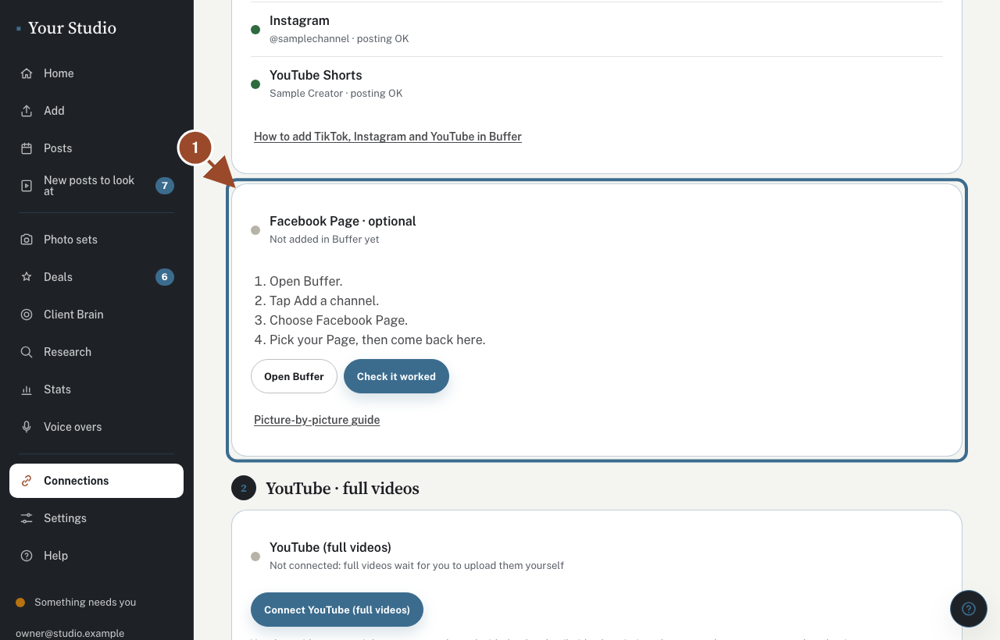
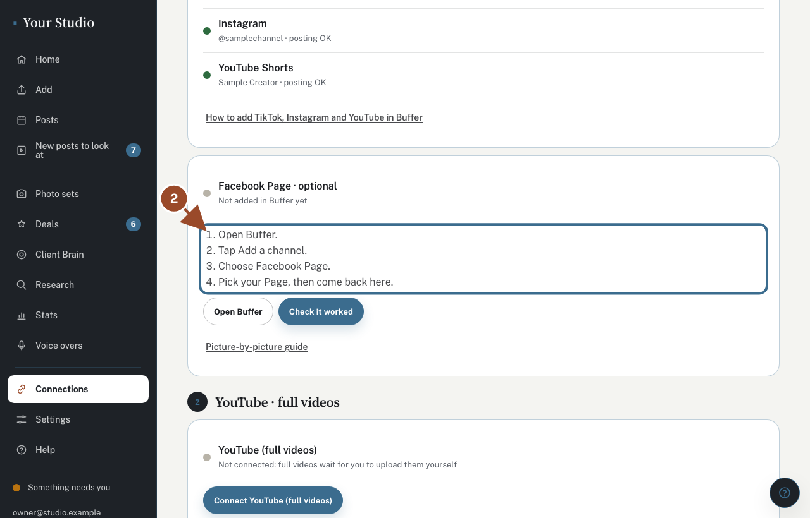
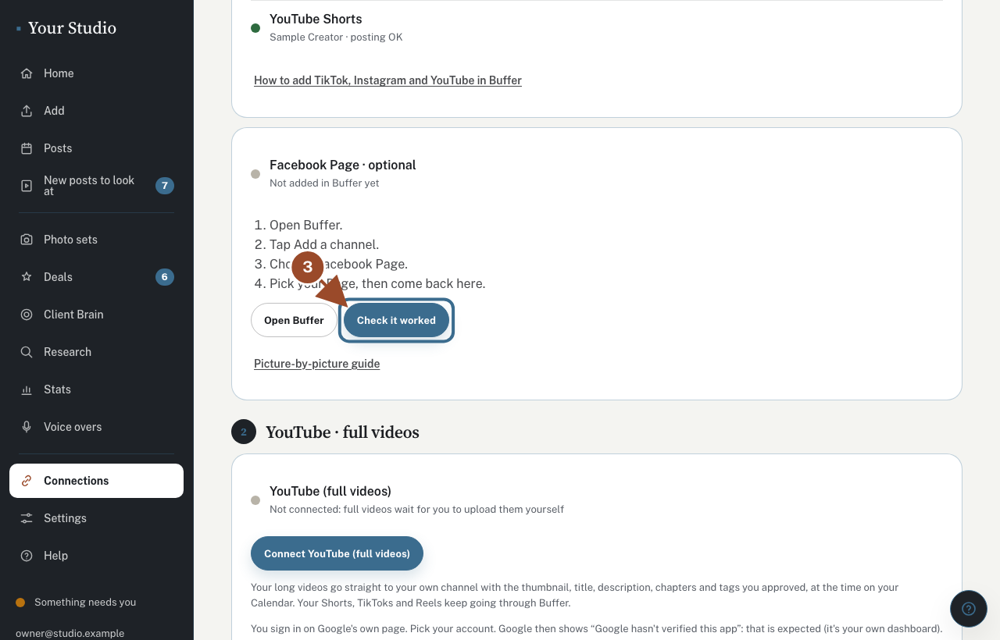

Your photo posts go to your Facebook Page through Buffer, the same free app that posts to Instagram and TikTok. It is optional. Until your Page is added, Facebook posts wait safely and nothing else changes.

## Find Facebook Page under Connections

<!-- target: [data-facebook-page] -->
<!-- shared -->

Open **Connections** (under **More**). Under **Posting**, the **Facebook Page** row says whether your Page is added.

## Add your Page in Buffer

<!-- target: [data-facebook-steps] -->
<!-- shared -->

Tap **Open Buffer**. Then: tap **Add a channel**, choose **Facebook Page**, and pick your Page.

## Check it worked

<!-- target: [data-check-facebook] -->
<!-- shared -->

Come back and tap **Check it worked**. The row turns green with your Page's name, and posts that were waiting go out, each with a heads-up first.

## Did this work?

If not, tap **No** below and we'll email your helper.
