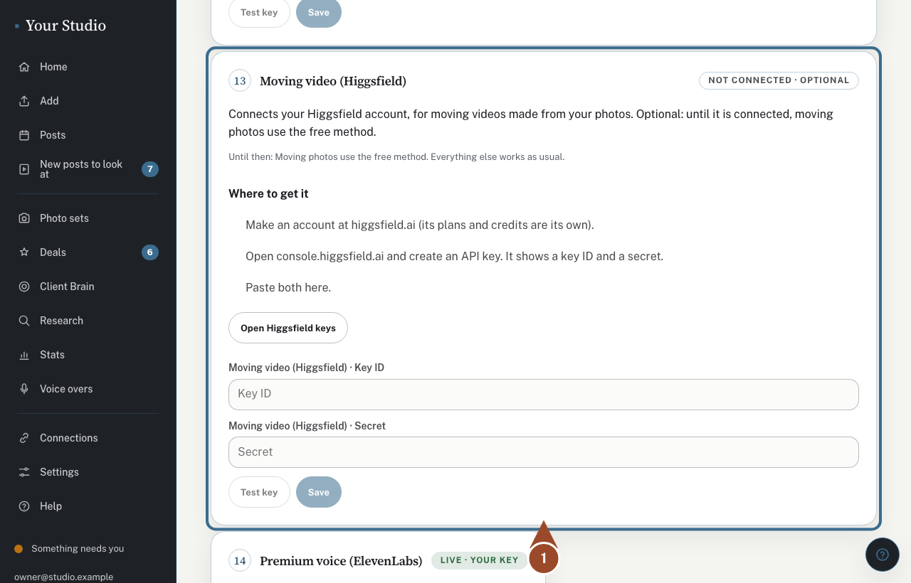
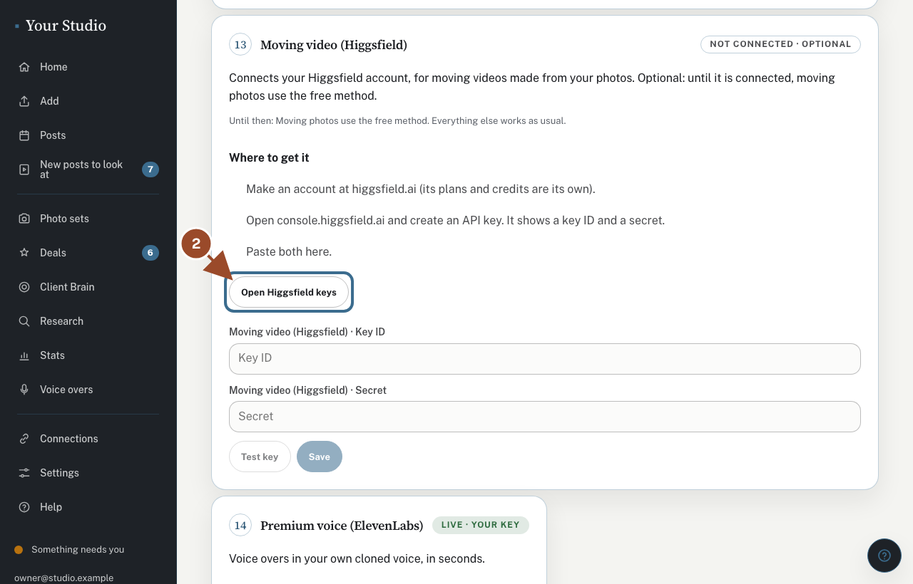
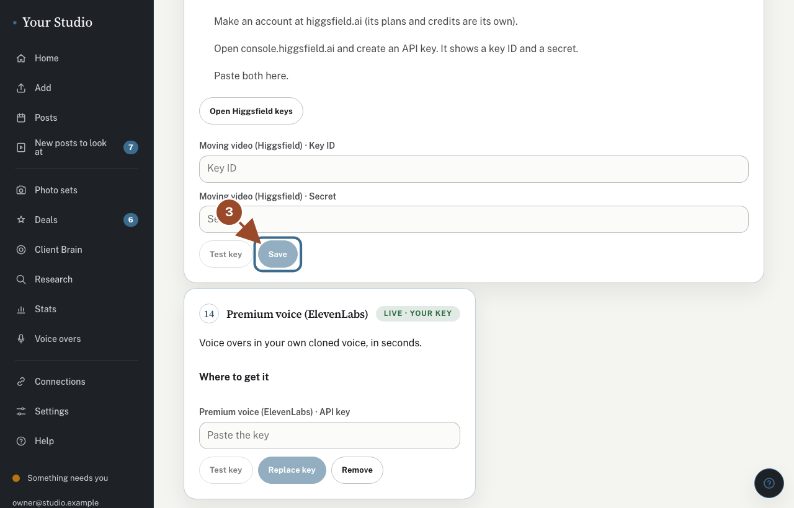

Higgsfield makes moving videos from your photos. It is optional: until it is connected, moving photos use the free method and everything else works as usual. Higgsfield's plans and credits are its own; the studio never buys anything.

## Find Higgsfield under Connections

<!-- target: #setup-higgsfield -->

Open **Connections** (under **More**), tap **Open your services and keys**, and find the **Moving video (Higgsfield)** card.

## Make a key

<!-- target: #setup-higgsfield a.btn -->

Tap **Open Higgsfield keys**, sign in, and create an API key. It shows a **key ID** and a **secret**. Copy both.

## Paste both and save

<!-- target: #setup-higgsfield button[type="submit"] -->

Paste the key ID and the secret, tap **Test key** if you like, then **Save**. The card then says **Live · your key**.

## Did this work?

If not, tap **No** below and we'll open the matching fix-it guide or email your helper.
