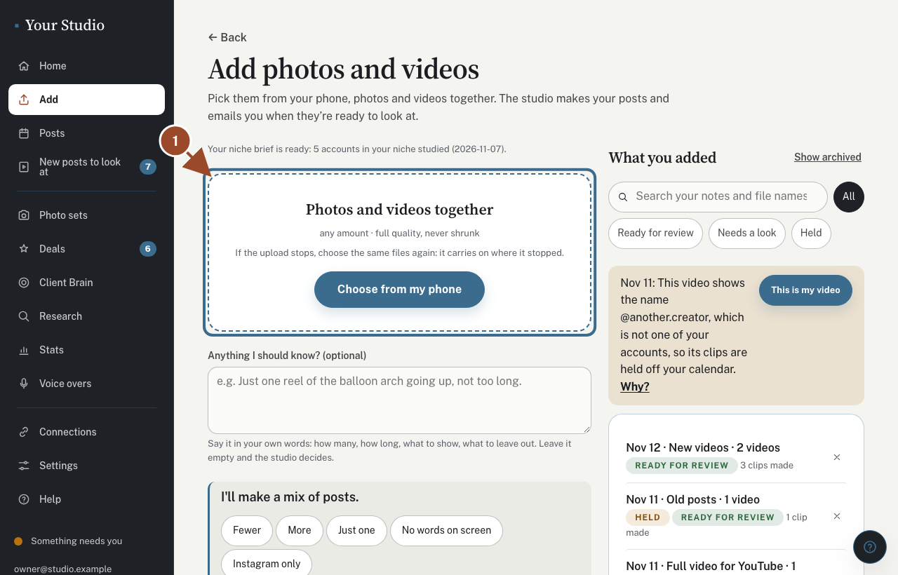
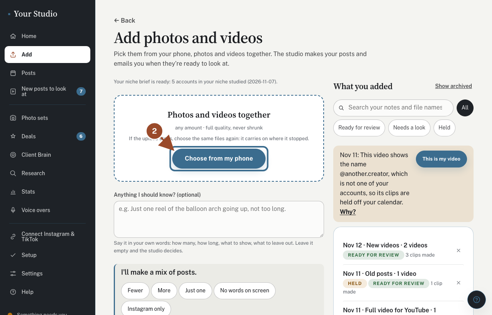
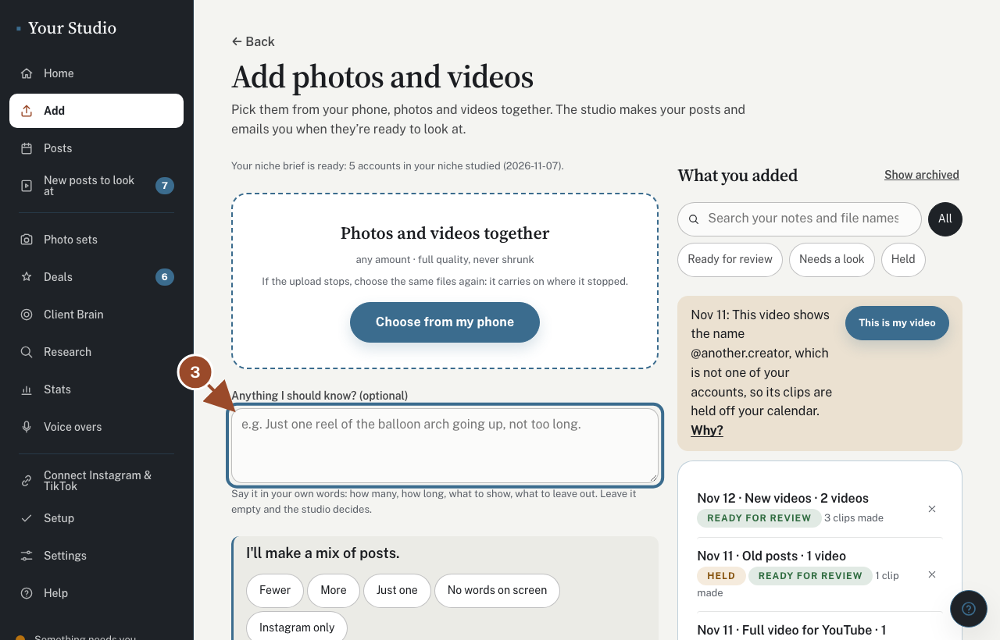
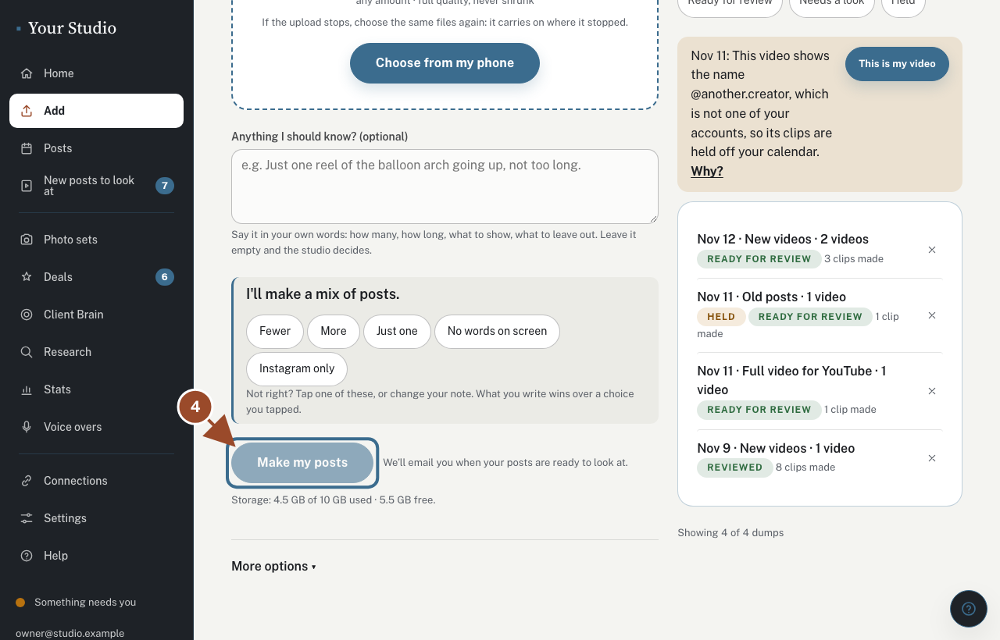
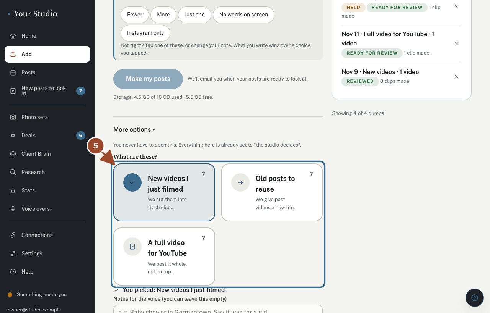
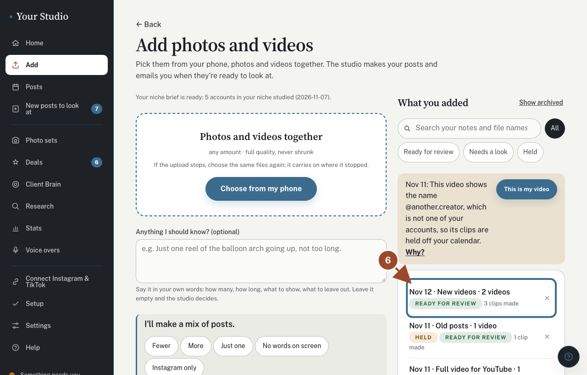

## Open Add

<!-- target: .dropzone -->

Tap **Add** at the bottom of the screen. Photos and videos go in the same place, together.

## Choose from my phone

<!-- target: [data-add-choose] -->

Tap **Choose from my phone** and pick as many photos and videos as you like. Any size is fine; keep the page open while they upload. If the upload stops, choose the same files again and it carries on.

## Add a note (you can leave it empty)

<!-- target: #notes -->

Say anything the studio should know, like "just one reel of the balloon arch, not too long". Leave it empty and the studio decides.

## Tap Make my posts

<!-- target: [data-dump-button] -->

Tap **Make my posts**. The studio makes your posts and emails you when they are ready to look at, usually 10 to 30 minutes later.

## More options (you never have to open this)

<!-- click: [data-more-options] > summary -->
<!-- target: .door-pick -->

**More options** is for the rare cases: **Old posts to reuse** (new posts from videos you posted before), **A full video for YouTube** (posted whole, never cut), notes for the voice over, and how to cut. Everything there is already set to "the studio decides".

## Watch it in the list

<!-- target: main a.list-row >> nth=0 -->

Everything you added shows here with how its posts are coming along, newest first, 20 at a time. Search your notes, or tap **Needs a look** to see the ones that did not finish. The × moves one you are done with to **Show archived** (Undo brings it right back).

## Did this work?

If not, tap **No** below and we'll open the matching fix-it guide or email your helper.
