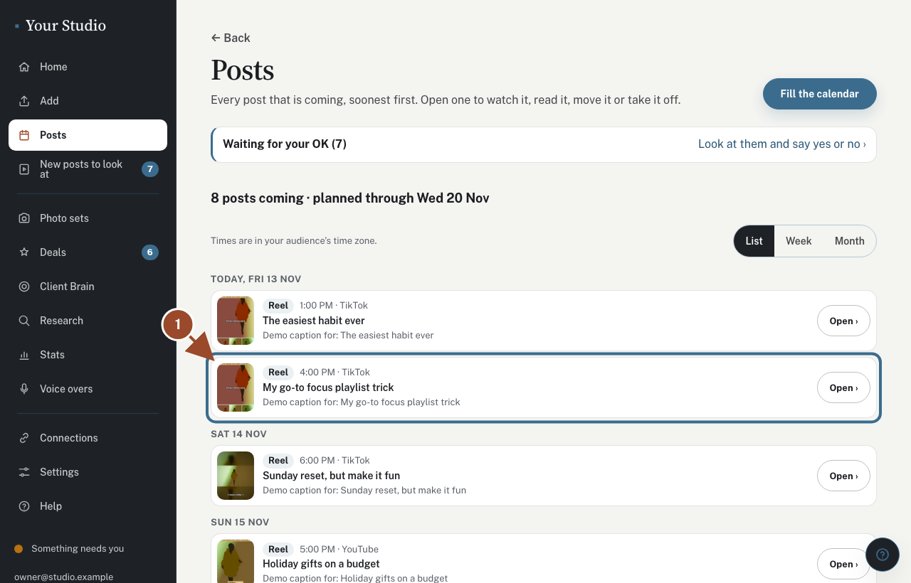
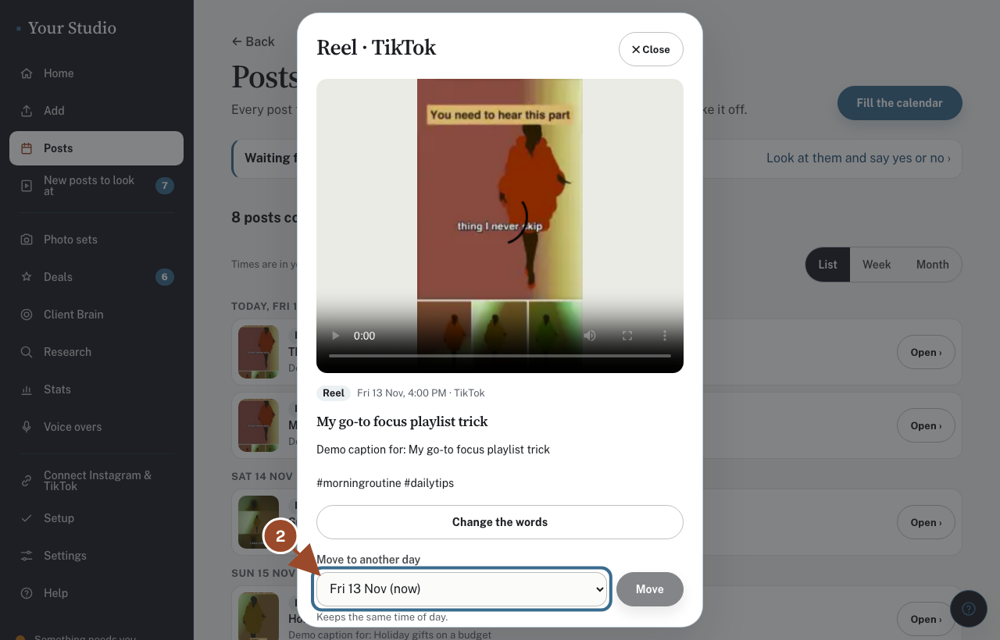
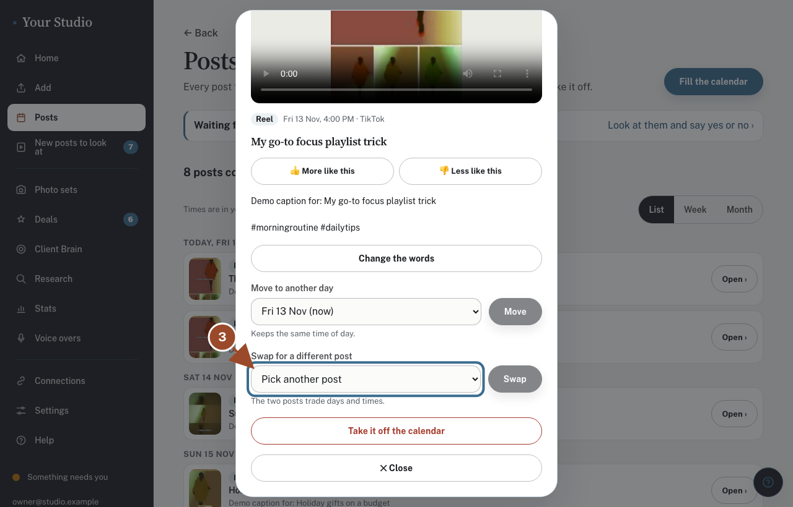
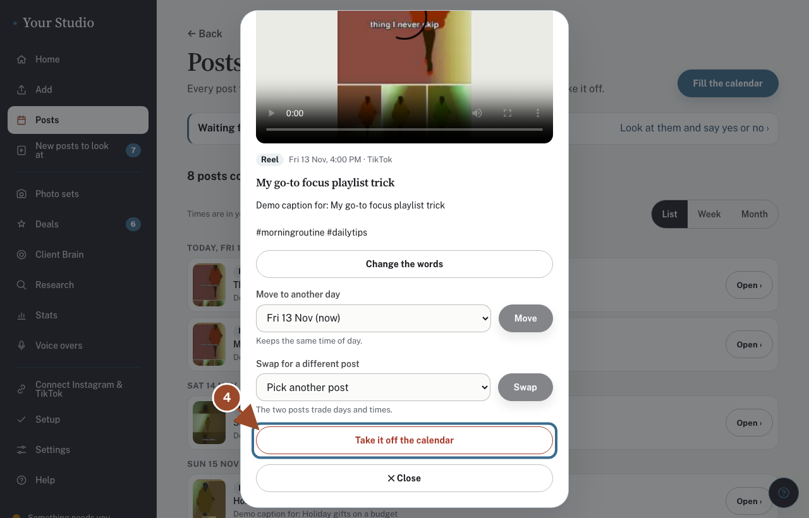
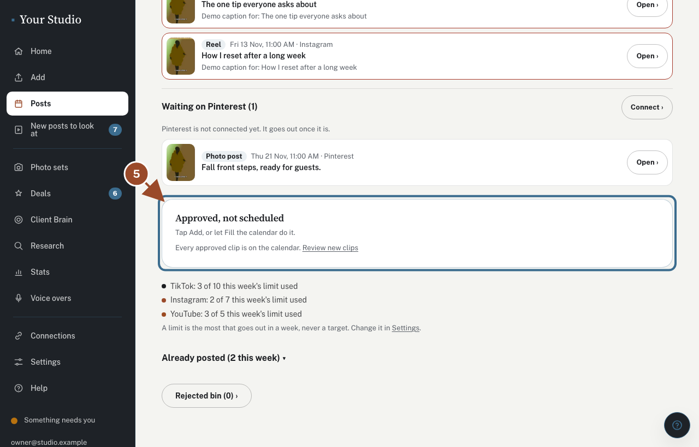
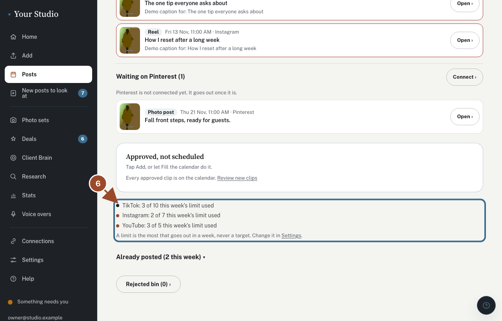

## Tap the post

<!-- target: [data-post="demo_post_h4"] -->

Open **Posts**. Every post that is coming is listed, soonest first. Tap **Open ›** on the one you want to change.

## Move it to another day

<!-- click: [data-post="demo_post_h4"] .post-open -->
<!-- target: #move-day -->

Pick a new day under **Move to another day** and tap **Move**. It keeps the same time. On a computer you can also tap **Week** and drag it.

## Or swap two posts

<!-- click: [data-post="demo_post_h4"] .post-open -->
<!-- target: #swap-with -->

Pick another post under **Swap for a different post** and tap **Swap**. The two trade days and times.

## Or take it off

<!-- click: [data-post="demo_post_h4"] .post-open -->
<!-- target: role=button[name="Take it off the calendar"] -->

Tap **Take it off the calendar**. The clip goes back to your approved pool. A photo post says **Skip this post** instead: a skipped post never goes out and waits in the **Rejected bin**.

## Approved, not scheduled

<!-- target: [aria-label="Approved, not scheduled"] -->

Clips waiting for a spot are listed here. Tap **Add** to place one yourself.

## Never more than the weekly limit

<!-- target: .cal-caps -->

Each app has a weekly limit (at most 10), written out under your posts. It is the most that goes out in a week, never a target. A full week says so; move a post out first.

## Did this work?

If not, tap **No** below and we'll open the matching fix-it guide or email your helper.
