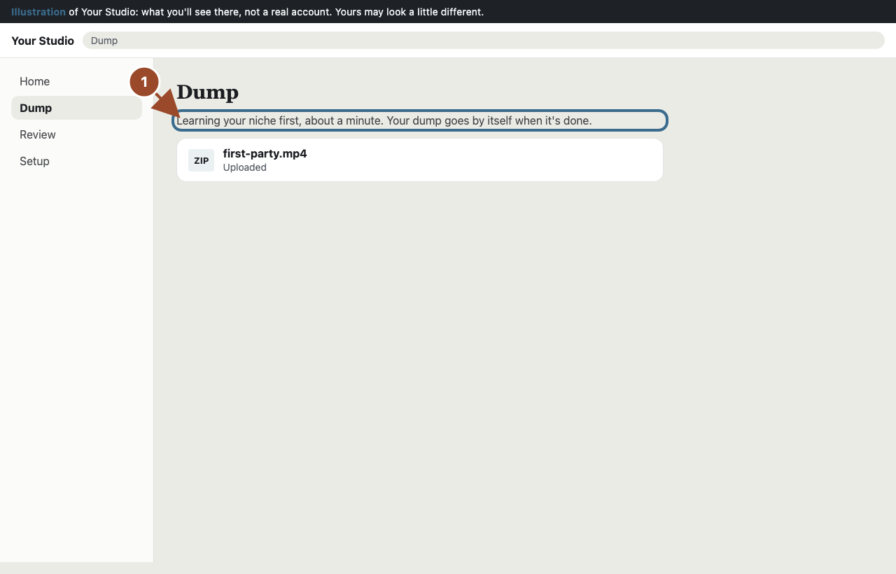
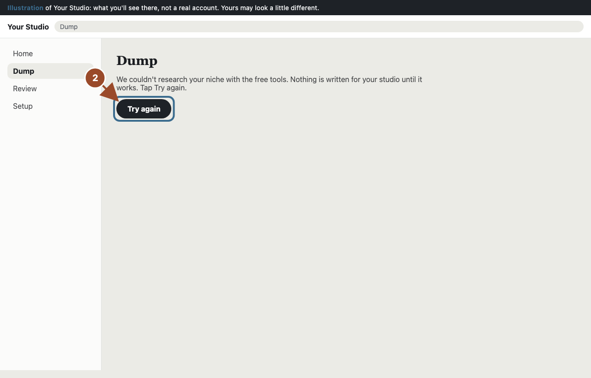
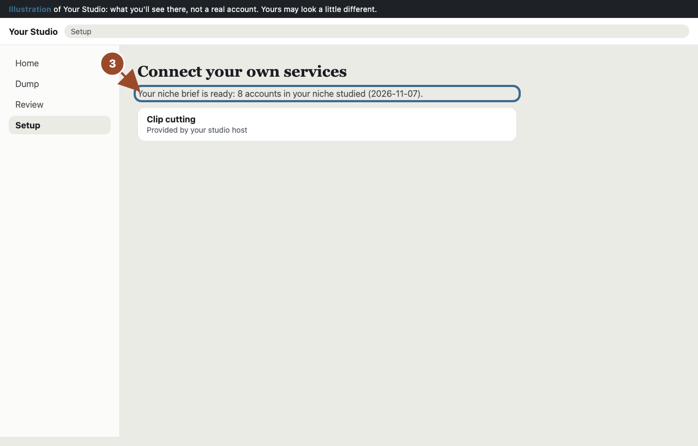

Before your studio writes anything for you, it studies your niche once: who buys, 5 to 10 accounts in your niche that do well, how their best posts open and how they ask people to book. Every clip, caption, on-screen line and photo post is written from that brief. It is free: free web search and free AI only.

## Your first upload waits about a minute

<!-- mock: studio-niche-learning -->

The first time you send a dump or make photo posts, it says **Learning your niche first**. Your dump is saved and goes by itself when the brief is in. It never runs again after that.

## If it couldn't research your niche, tap Try again

<!-- mock: studio-niche-stop -->

The free tools did not find enough real accounts this time. Nothing is written for your studio until it works, so you never get generic copy. Tap **Try again**. If it fails again, check that your Brand Profile says what you sell and where.

## See that it's ready

<!-- mock: studio-niche-ready -->

Once it's in, **Setup** and **Dump** say how many accounts in your niche were studied and when. Nothing more to do: every clip and post is written from it.
