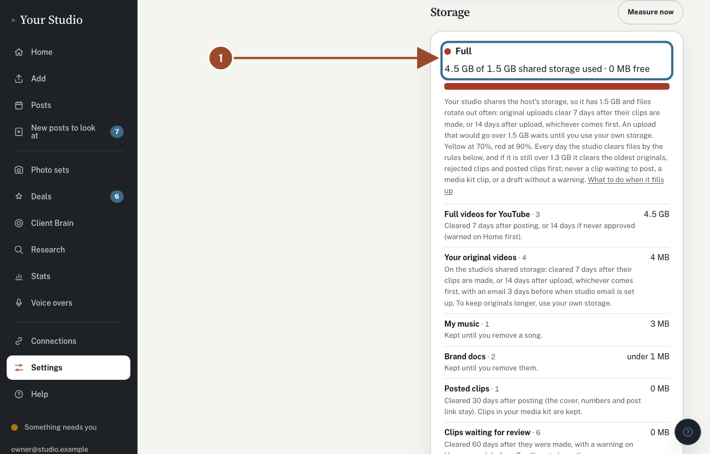
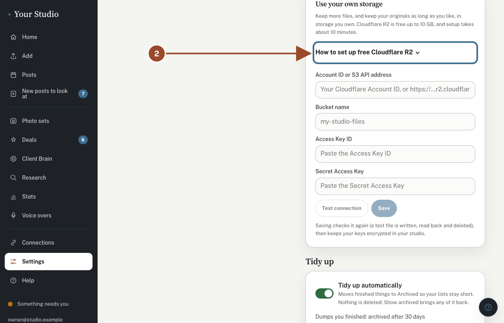
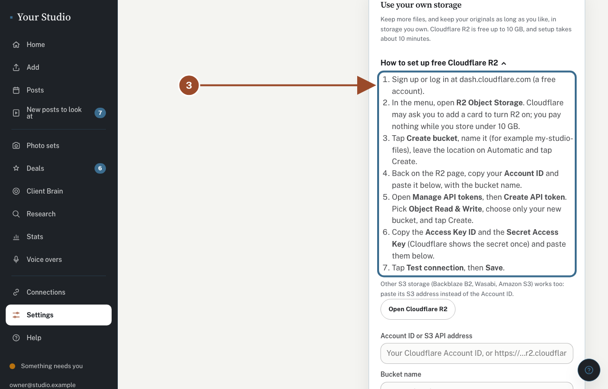
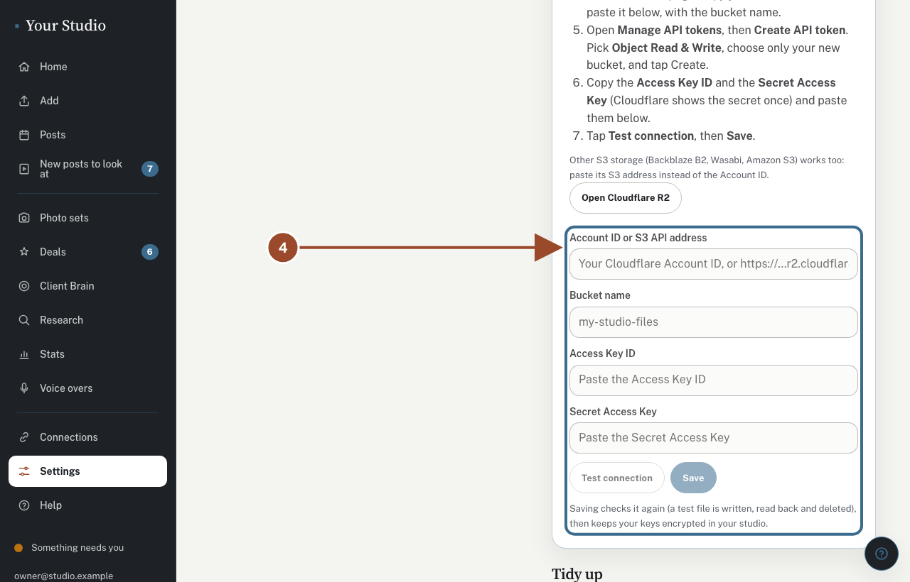

Your studio can keep your files in storage you own. Some studios have no shared storage at all, and the shared storage other studios use is small and clears original uploads after a few days. Cloudflare R2 is free up to 10 GB.

## Open Settings → Storage

<!-- route: /settings#storage -->
<!-- target: #storage .storage-head -->

The Storage meter says how full your storage is and where your files go now. **Use your own storage** is just below it.

## Make a free R2 bucket

<!-- route: /settings#own-storage -->
<!-- target: .own-storage details summary -->

Open **How to set up free Cloudflare R2** and follow it: a free Cloudflare account, **R2 Object Storage**, **Create bucket**. Cloudflare may ask for a card to turn R2 on; under 10 GB stored, you pay nothing.

## Make a key for that bucket

<!-- route: /settings#own-storage -->
<!-- click: .own-storage details summary -->
<!-- target: .own-storage details ol -->

In R2, open **Manage API tokens** and create a token with **Object Read & Write** on your new bucket only. Copy the **Access Key ID** and **Secret Access Key** (the secret shows once), and your **Account ID** from the R2 page.

## Paste, Test connection, Save

<!-- route: /settings#own-storage -->
<!-- target: .own-storage form.setup-form -->

Tap **Add my own storage** if the boxes are not open yet. Paste the Account ID, bucket name and both keys, then **Test connection**: the studio writes a small test file, reads it back and deletes it. Then **Save**. New uploads, clips and voice overs go to your bucket from then on.

## Did this work?

If not, tap **No** below and we'll open the matching fix-it guide or email your helper.
