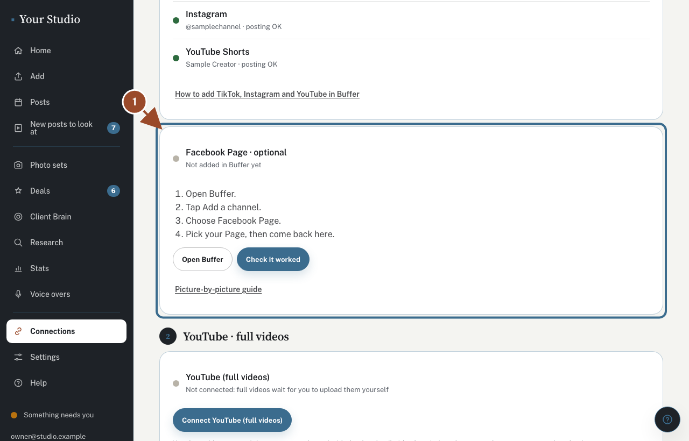
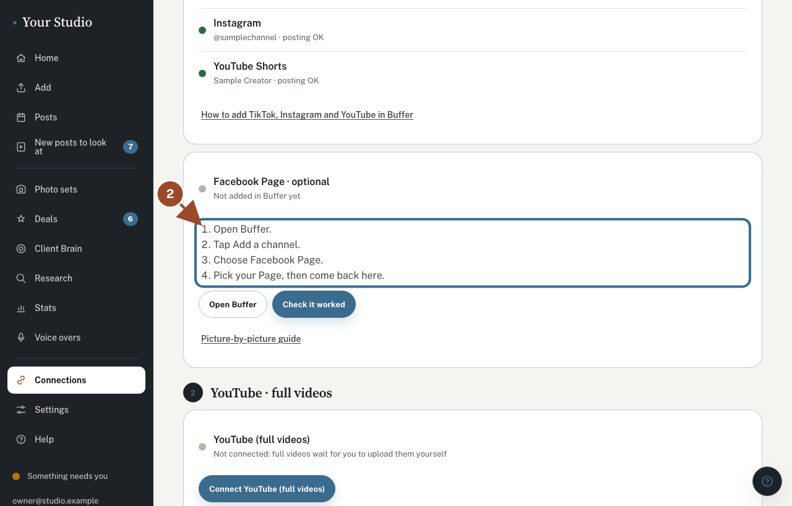
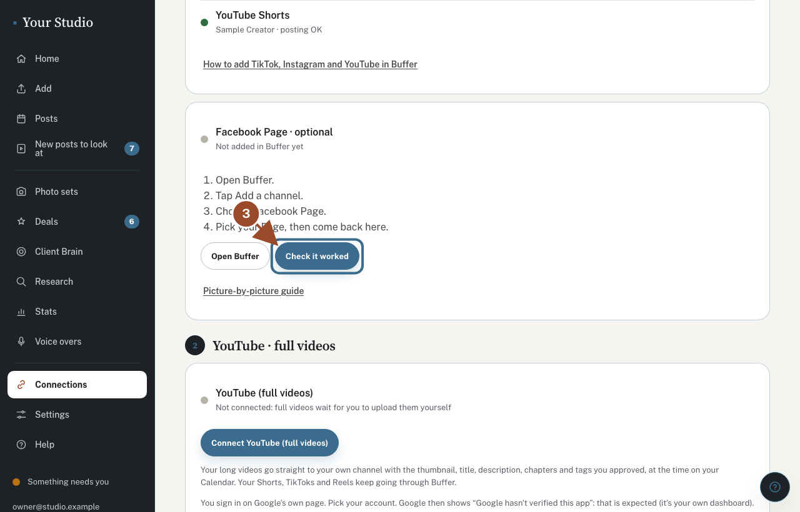

Buffer lost its link to your Facebook Page, or the Page is paused inside Buffer. Your posts wait safely until it is connected again.

## See what Facebook needs

<!-- target: [data-facebook-page] -->
<!-- shared -->

Open **Connections** (under **More**). The **Facebook Page** row says what is wrong: not added, or paused inside Buffer.

## Fix it in Buffer

<!-- target: [data-facebook-steps] -->
<!-- shared -->

Tap **Open Buffer**. Reconnect your Facebook Page there, or press **Resume** if it is paused.

## Check it worked

<!-- target: [data-check-facebook] -->
<!-- shared -->

Come back and tap **Check it worked**. Waiting posts go out, each with a heads-up first.

## Did this work?

If not, tap **No** below and we'll email your helper.
