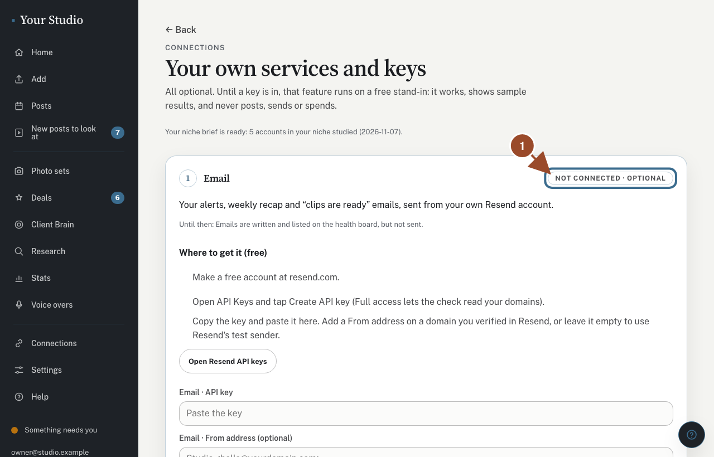
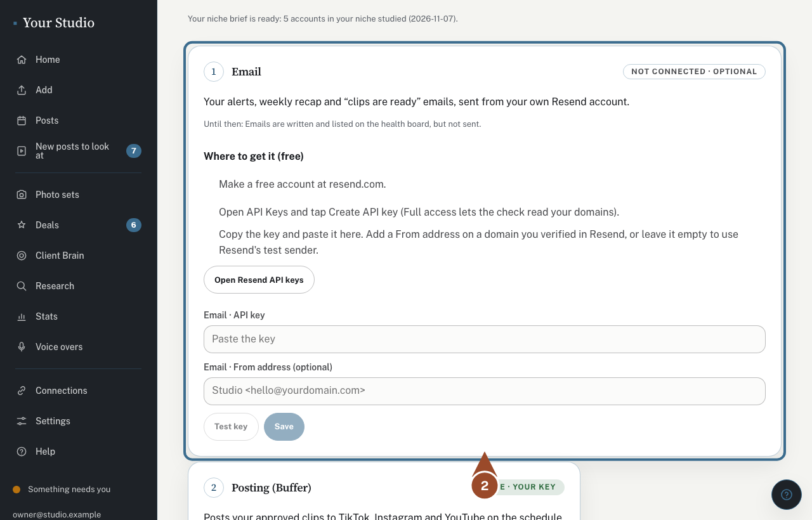
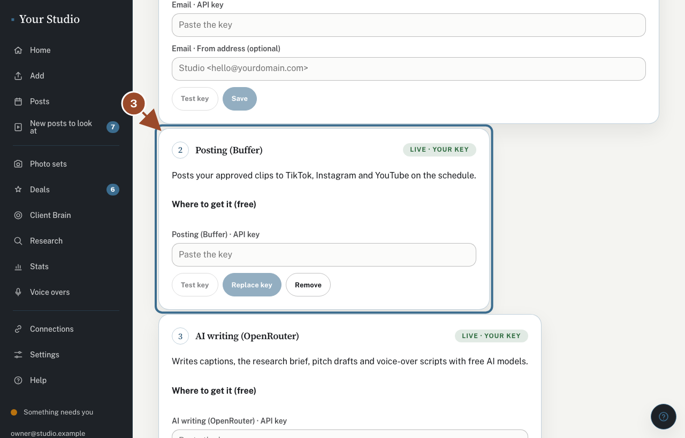

Your studio runs on a few outside services. Each one uses your own account and key; nothing of anyone else's is loaded.

## A free stand-in runs until you add a key

<!-- route: /setup -->
<!-- target: .setup-step:has(#setup-resend) .pill -->

All of this is optional. Until a service has its key, its feature runs on a free stand-in: it works and shows sample results, but never posts, sends or spends. The pill on each card says which.

## Open your services and keys

<!-- route: /setup -->
<!-- target: .setup-steps > li >> nth=0 -->

Tap **More**, then **Connections**, then **Open your services and keys** at the bottom. One card for each service that is yours to set up. A service that is already set up for you is not listed.

## Follow one card at a time

<!-- route: /setup -->
<!-- target: .setup-step:has(#setup-buffer) -->

Each card says what it powers, what happens until it is connected, and where to get the key. Paste it, tap **Test key** to check it without saving, then **Save**.

## Did this work?

If not, tap **No** below and we'll open the matching fix-it guide or email your helper.
