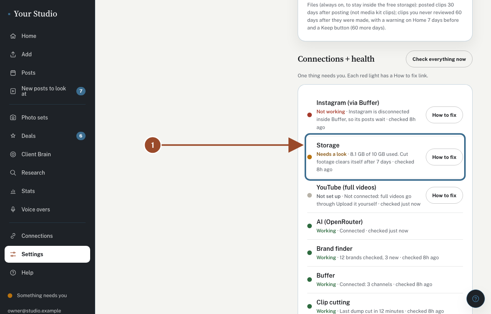
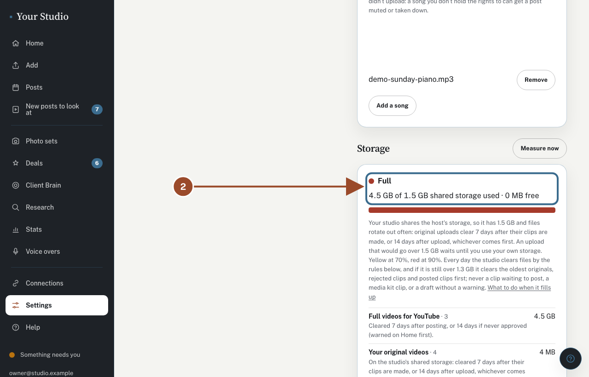
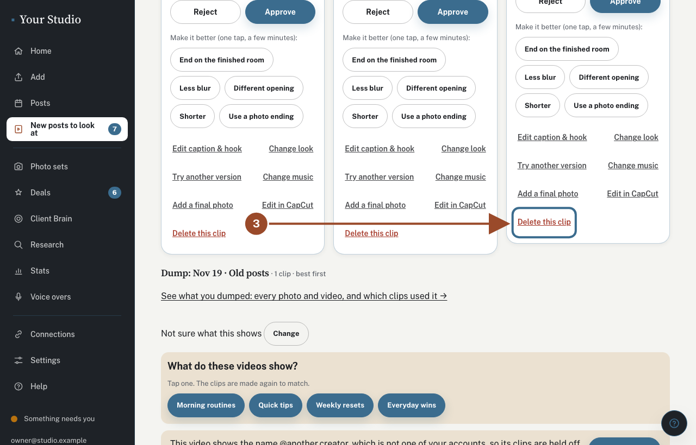
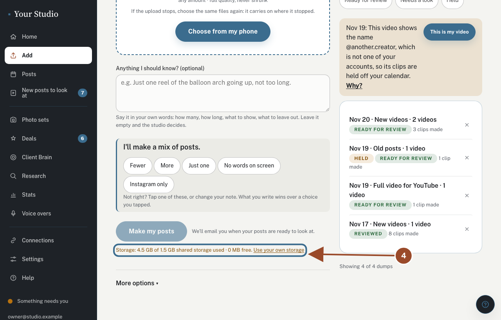

Every day the studio clears files by its rules: posted clips after 30 days, unreviewed clips after 60 days with a warning first, and your originals (on shared storage 7 days after their clips are made or 14 days after upload; in your own storage 30 days after they are cut, with an email 14 and 3 days before). If it is still over 90% it clears the oldest originals, rejected clips and posted clips early; it never touches a clip waiting to post, a media kit clip, or a clip it has not warned you about. The lasting fix for shared storage is your own: Settings → Storage → Use your own storage (Cloudflare R2 is free up to 10 GB).

## The Storage light

<!-- target: [data-health="Storage"] -->

In **Settings**, **Storage** says how much is used. Yellow means filling up; red means new videos may not upload.

## See what takes the space

<!-- target: #storage .storage-head -->

The **Storage** meter lists each kind of file, biggest first. Usually it is clips waiting for review or a full video for YouTube.

## Red? Delete clips you won't post

<!-- route: /review -->
<!-- target: [data-clip-id="demo_new_3"] >> text=Delete this clip -->

In **New posts to look at**, tap **Delete this clip** on clips you'll never post, then **Measure now** in Settings.

## Hold off on very long videos

<!-- route: /dump -->
<!-- target: [data-free-space] -->

Until it's green again, add shorter videos. The Add screen shows the free space before you upload.

## Did this work?

If not, tap **No** below and we'll open the matching fix-it guide or email your helper.
