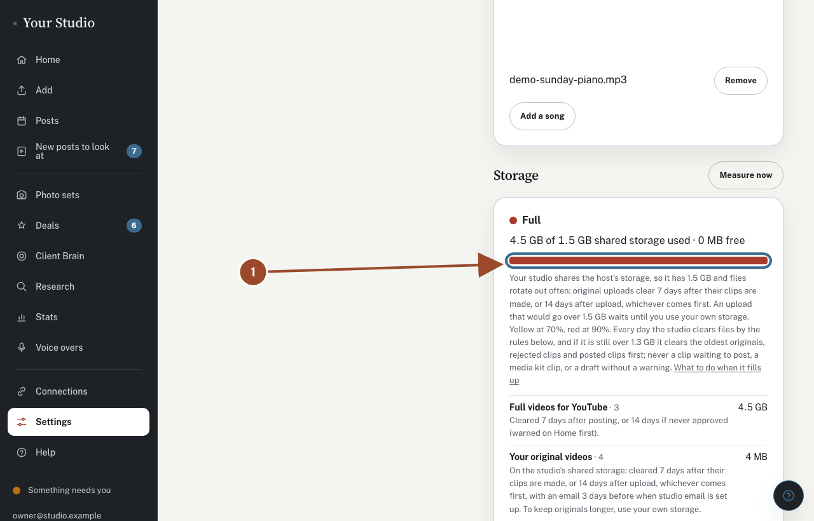
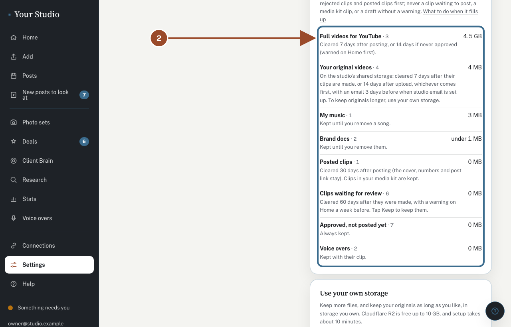
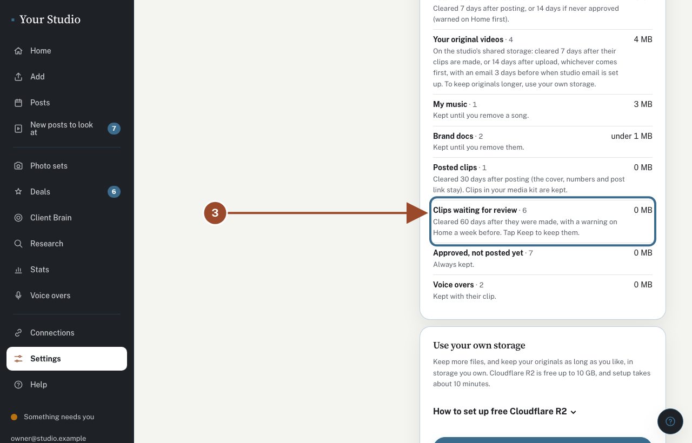
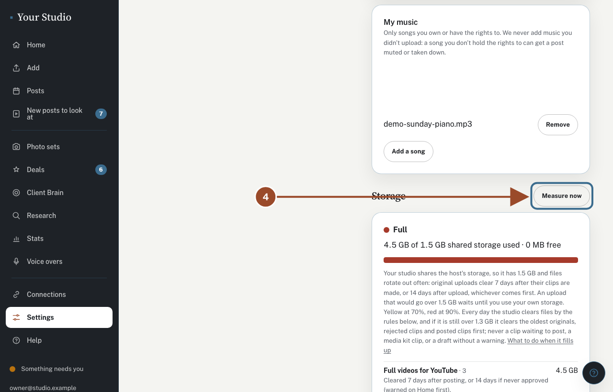
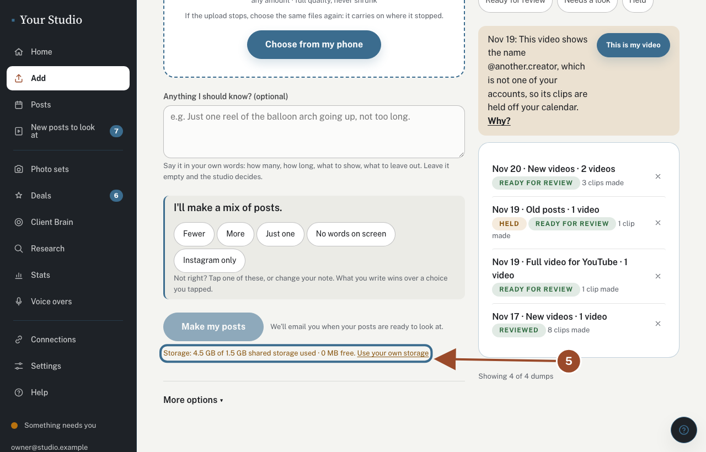

Your studio keeps your files either on the studio's shared storage (a small share, where files rotate out often) or in your own storage (Cloudflare R2 is free up to 10 GB). It stays under its limit by clearing files you no longer need, and it always warns you first before anything you have not posted goes.

## The storage meter

<!-- route: /settings -->
<!-- target: #storage .storage-meter -->

**Settings → Storage** shows where your files go and how full it is: green, yellow from 70%, red from 90%. On shared storage, an upload that would go over the share waits until you add your own storage.

## What takes the space, and each rule

<!-- route: /settings -->
<!-- target: .storage-kinds -->

Each kind of file says how long it is kept. Posted clips: 30 days after posting. Originals on shared storage: 7 days after their clips are made (14 after upload at most). In your own storage: 30 days, with emails before (Download all, or Keep them). Media-kit clips and approved clips waiting to post: always kept.

## Clips you never reviewed

<!-- route: /settings -->
<!-- target: [data-storage-kind="clips_drafts"] -->

A clip you never approved is cleared 60 days after it was made. A week before, Home says so with **Keep them** (60 more days) and each clip in New posts to look at shows its date.

## Measure it now

<!-- route: /settings -->
<!-- target: #storage button:has-text("Measure now") -->

The dashboard measures every day on its own. **Measure now** checks this minute, for example after you delete clips.

## Free space before you dump

<!-- route: /dump -->
<!-- target: [data-free-space] -->

The Add screen shows how much space is free before you upload. Need more? See **Use your own storage**.

## Did this work?

If not, tap **No** below and we'll open the matching fix-it guide or email your helper.
