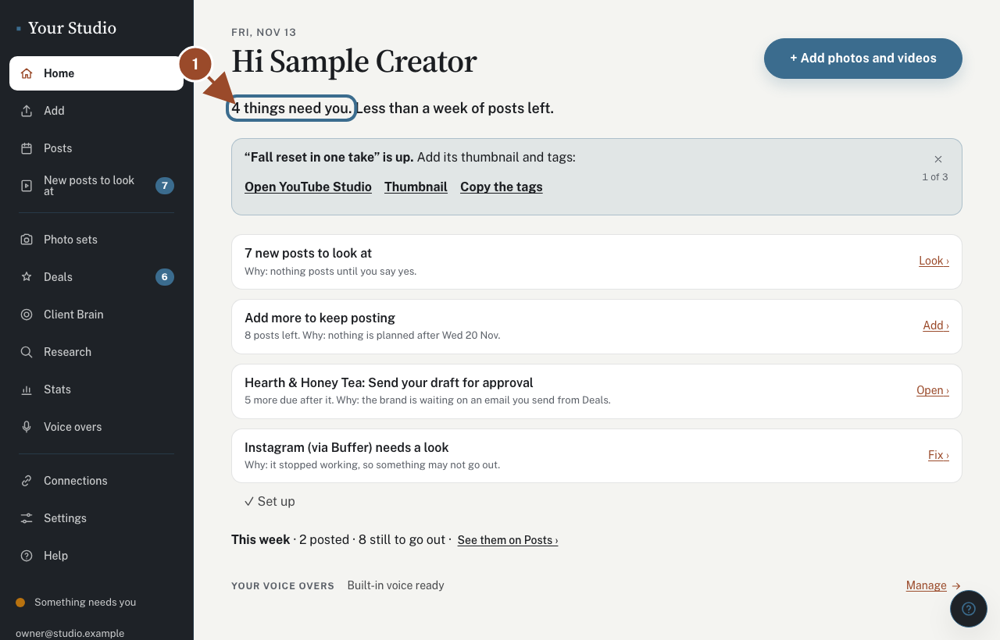
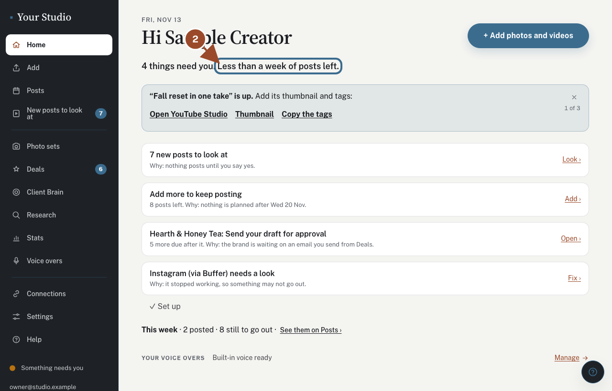
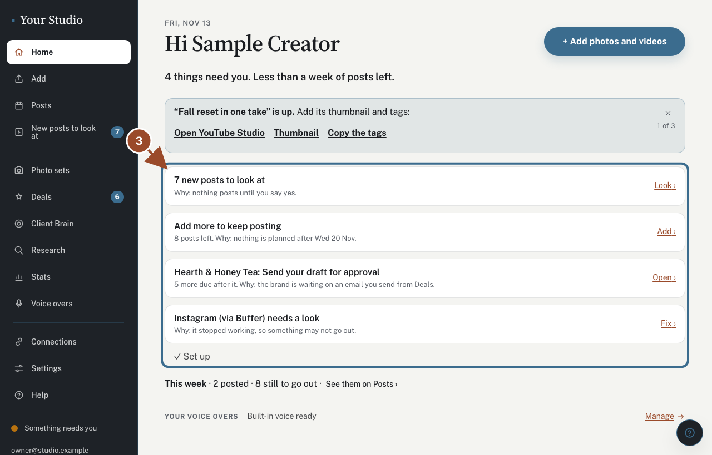
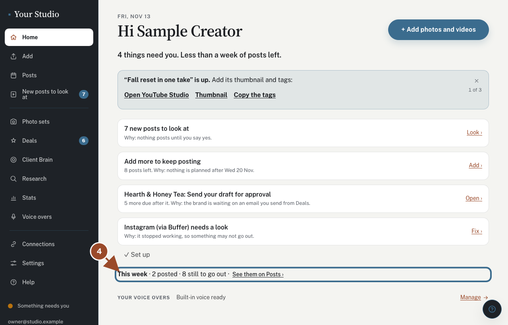
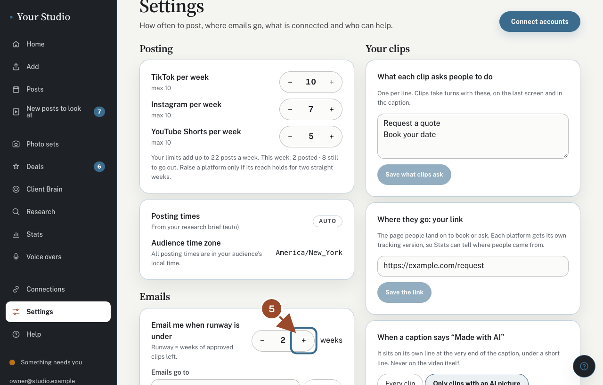

## Does anything need you?

<!-- target: [data-needs-you] -->

The top line of **Home** says how many things need you today, or that nothing does.

## How many weeks of posts are left

<!-- target: [data-posts-left] -->

One line says about how long your posts will last. When it gets short you also get an email with ideas for what to film.

## The list

<!-- target: [data-home-list] -->
<!-- shared -->

Each row is one thing that needs you, with why and one button: new posts to look at, add more, or something to fix. Nothing else is yours to do.

## This week

<!-- target: [data-this-week] -->

How many posts went out this week and how many are still to go out. Tap **See them on Posts** for every one of them.

## Change the reminder email

<!-- route: /settings -->
<!-- target: role=button[name="More weeks of runway"] -->

Open **Settings** and change when the reminder email comes with **+** and **−**.

## Did this work?

If not, tap **No** below and we'll open the matching fix-it guide or email your helper.
